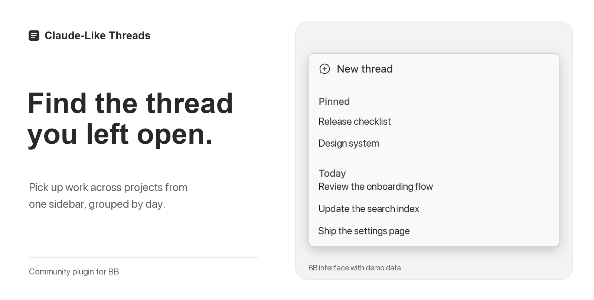
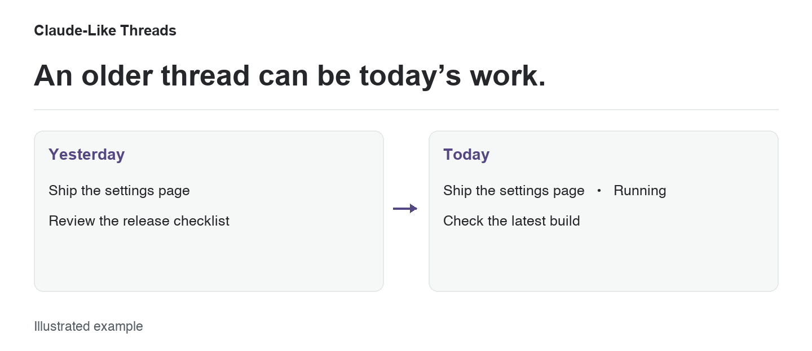
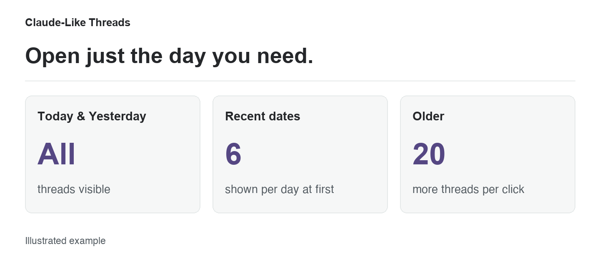
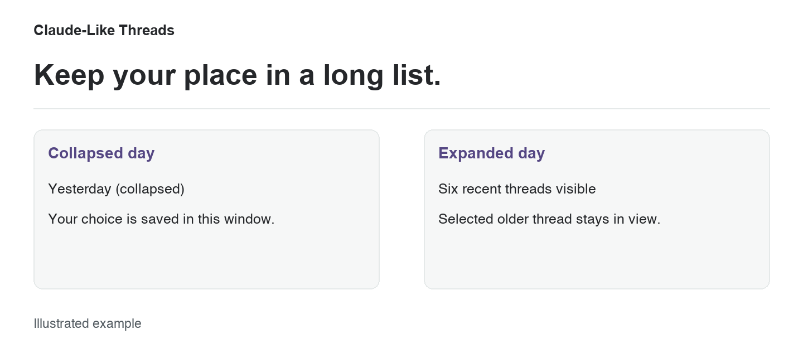
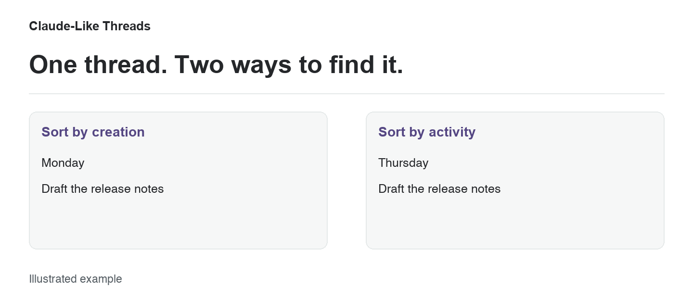

# Claude-Like Threads



**One timeline across projects, newest activity first.** Open Today to see what’s running and what you just worked on. Yesterday and the dated groups below it take you back to an earlier conversation, even when you’ve forgotten which project it belongs to.

## Install

```sh
bb plugin install git:https://github.com/startsevdev/bb-plugin-claude-like-threads.git@v0.1.2
```

In **Settings → Appearance**, choose **Claude-Like Threads** as your thread list. Use chronological organization and sort by **Updated** to see recent activity first.

## Go back a day



**Today and Yesterday** show every thread in those groups. A conversation running now appears under Today when sorted by activity. Pins stay at the top, with your custom sections and thread menus available as usual.

**Other days in the past week** opens with six threads per day. **Older** shows twenty at a time. Click **Show more** to go further back. Collapse any day to make room for the one you need. The sidebar remembers the groups you collapsed in that window.



## Keep your place in a busy sidebar

Long titles stay on one line, and date headers scroll away with their rows. Open an older thread and it stays visible in its expanded day, even beyond the initial row limit. Pins, drag-and-drop, custom sections and right-click menus still work the way they do in BB.



## Choose what a day means

| Sort | What you see |
| --- | --- |
| Updated | Threads grouped by their latest activity. Useful when you move between projects throughout the day. |
| Created | Threads grouped by the day you started them. |
| Alphabetical | A title-sorted list without date headers. |



<details>
<summary>Set the chronological layout from the CLI</summary>

```sh
bb thread-list-by-day prefs set organizationMode chronological
bb thread-list-by-day prefs set chronologicalSort updated
bb thread-list-by-day prefs set sortDirection descending
```

</details>

## Compatibility

Verified with BB 0.49.0. The packaged sidebar is based on BB’s bundled thread list. The repository includes the installed snapshot, the original patch script and the upstream license. Installation uses the snapshot. [Upstream license](LICENSE.bb)
